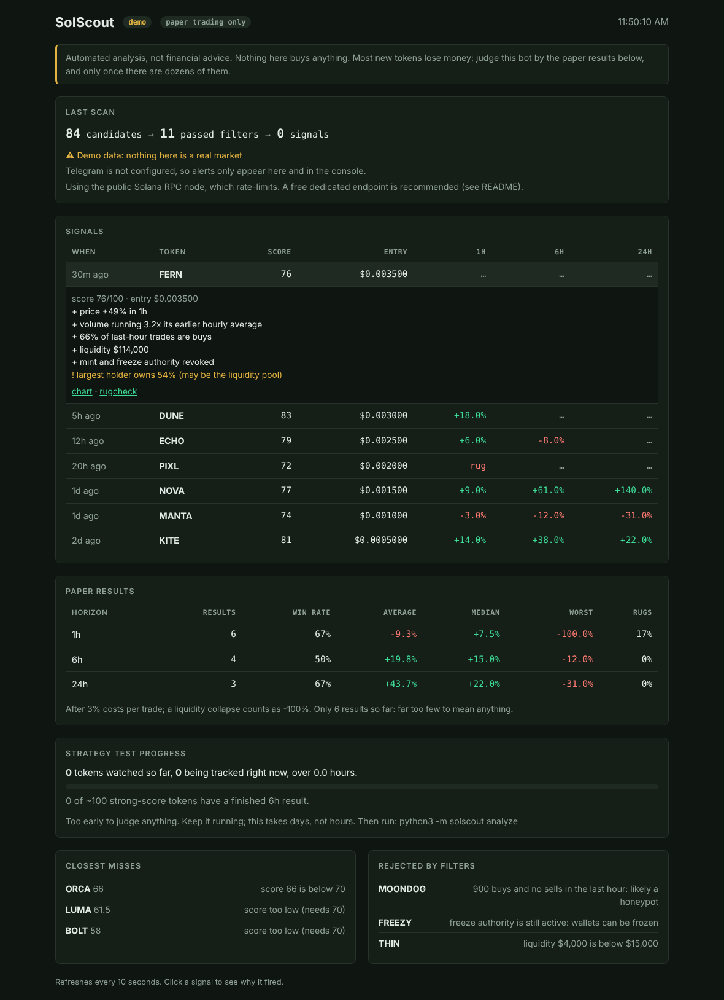

# SolScout

A signal bot for Solana tokens. It watches new and trending pairs, throws out the obvious traps (rugs, honeypots, unrevoked authorities, concentrated holders), scores what is left, and alerts you with the reasons. Every signal is **paper-traded**, so you can measure whether the bot has any edge before putting money anywhere near it.




*The screenshot shows built-in demo data, not a real market.*

## How it works

```
 DexScreener ─┐                         ┌─ hard filters: liquidity, age, activity, honeypot
 GeckoTerminal├─► candidates ─► market ─┤
              │                  data   └─ score 0-100 with reasons
 Solana RPC ──┬─► on-chain safety: mint / freeze authority, Token-2022, holder concentration
 RugCheck ────┘   (RugCheck is the fallback when the RPC node rate-limits)
                                   │
                signals (cooldown + daily cap) ─► Telegram / dashboard
                                   │
                paper tracker: result at 1h / 6h / 24h, rug detection, costs deducted
```

Score components (max points): momentum 25, volume acceleration 25, buy pressure 15, liquidity 15, age 10, on-chain safety 10. A token already up hundreds of percent over 6 hours is penalised as late. If the on-chain check cannot run, the token is **not** signalled; it shows up under "Closest misses" with the reason.

## Try it (no network, no keys)

```bash
python3 -m solscout demo             # whole pipeline on sample tokens, in the terminal
python3 -m solscout serve --demo     # the dashboard with sample data
```

## Run it for real

No dependencies to install: it uses only the Python 3.12+ standard library.

```bash
cp .env.example .env
python3 -m solscout check            # which data sources work from this machine
python3 -m solscout serve            # dashboard at http://127.0.0.1:8080 + scanning worker
```

Other commands: `scan` (one scan, with near-misses printed), `run` (worker only), `signals`, `stats`, `analyze` (test the strategy, see below).

### Recommended setup

1. **A dedicated RPC URL.** The public Solana node returns HTTP 429 quickly. Get a free key at [helius.dev](https://www.helius.dev), then set `SOLSCOUT_RPC_URL` in `.env`.
2. **Telegram alerts.** Create a bot with @BotFather, then set `SOLSCOUT_TELEGRAM_TOKEN` and `SOLSCOUT_TELEGRAM_CHAT_ID` (steps are in `.env.example`). Keep `.env` out of git.
3. **Leave it running.** Paper results only mean something after dozens of signals, which takes days.

## Testing the strategy

You cannot know whether a signal strategy works by looking at a few alerts. SolScout records everything it needs to test itself properly:

1. **Leave `python3 -m solscout serve` running.** Every token that passes the market filters is watched for 25 hours (price and liquidity every 5 minutes), whether or not it became a signal. That includes the ones the bot rejected, which is what lets us compare its picks against everything else.
2. **After a few days, run `python3 -m solscout analyze`.** It prints six sections and a verdict:
   - does a higher score actually predict better returns than the baseline of all watched tokens?
   - a threshold sweep, tuned on older data and judged on the newest 30% (held out)
   - which inputs matter (volume, buy ratio, momentum, liquidity, age)
   - exit rules: fixed holds, take-profit and stop-loss pairs, trailing stops
   - the cost of entering 5, 10 or 15 minutes late
   - sensitivity to trading costs
3. **Believe only the held-out rows and the verdict.** Trying many thresholds and exit rules always finds some winner by luck. The report says `NOT ENOUGH DATA`, `NO PROVEN EDGE`, `LOSES MONEY` or `PROMISING, NOT PROVEN`, and it is deliberately hard to get the last one.

The dashboard's "Strategy test progress" panel shows how far along the data collection is. Collection takes days, not hours.

Realism built in: a default 5-minute entry delay (you are never instant), 3% round-trip costs, a liquidity collapse counts as a total loss (it must persist for two readings, so one API glitch is not a rug), and a price shown while the pool looks drained is never trusted.

The analysis code itself is tested on synthetic markets: it finds a planted edge, does not invent one from noise, and flags a losing strategy.

## Trying it with real money ($5-10)

Only after the test says so, and understand what $5-10 can and cannot do. It cannot tell you whether the strategy has an edge (that needs hundreds of trades, which the paper test provides). What it can do is test **execution**: real fees, real slippage, how late you really are, and whether the tokens can actually be sold.

**Go-live checklist. All must be true:**
- [ ] `analyze` says `PROMISING, NOT PROVEN` on held-out data with at least 30 completed results.
- [ ] The edge survives `python3 -m solscout analyze --delay-min 10` and a 5% cost setting (`SOLSCOUT_PAPER_COST_PCT=5`).
- [ ] You have run it on a fresh batch of data, not the same data you tuned on.
- [ ] You can afford to lose the entire test amount.

**Rules for the test:**
- Use a **new wallet that holds only the test money**. Never your main wallet, never a seed phrase typed anywhere except the wallet app itself.
- **The bot never gets keys and never trades.** You buy and sell by hand in your wallet or a DEX app, from the alerts.
- About $5 per position, at most two open at once, and stop for good when the budget is gone.
- Use the EXIT ALERT messages (take profit +50%, stop -20%, liquidity drained) as prompts. Those levels are untuned defaults until section 4 of the report suggests better ones (`SOLSCOUT_EXIT_TAKE_PROFIT_PCT`, `SOLSCOUT_EXIT_STOP_LOSS_PCT`).
- Write down every trade (signal price, your fill, your exit) and compare with paper results after about 20 trades. Expect real results to be worse than paper.
- Selling is the risky part. A token can pass every check here and still be impossible to sell. That is why the amount is small.

## Reading the results honestly

- Paper results subtract 3% per trade for fees and slippage, and count a liquidity collapse as a 100% loss.
- Ten results is noise. Wait for dozens.
- Paper fills assume you could trade at the signal price. Real fills on thin pools are worse.
- "Holders ranked 2 to 10" excludes the largest holder because that is usually the liquidity pool. It is a heuristic, not a guarantee.
- A quiet dashboard is normal. The filters are strict on purpose.

## Deploying

The worker has to stay running, and its SQLite file has to survive restarts, so free "sleeping" web hosts are a poor fit (they stop scanning and wipe the data).

- **Your own computer or a small VPS:** `python3 -m solscout serve`. Simplest, and the data stays in `solscout.db`.
- **Docker with a volume** (Fly.io, Railway, any VPS):
  ```bash
  docker build -t solscout .
  docker run -d -p 8080:8080 -v solscout-data:/data --env-file .env solscout
  ```
- **Always set `SOLSCOUT_DASHBOARD_PASSWORD`** before exposing the dashboard to the internet. `/health` stays open for platform health checks.

## Configuration

Everything is a `SOLSCOUT_*` environment variable; defaults are in `solscout/config.py`. The ones you are most likely to change: `SIGNAL_THRESHOLD` (70), `MIN_LIQUIDITY_USD` (15000), `MAX_SIGNALS_PER_DAY` (10), `SCAN_INTERVAL_S` (60), `PAPER_COST_PCT` (3).

## Tests

```bash
pip install -r requirements-dev.txt
python -m pytest -q
```

## Roadmap

- [x] Engine: filters, scoring, signals, paper tracker, Telegram, CLI
- [x] Dashboard, RPC rate-limit handling, RugCheck fallback, near-miss visibility
- [x] Strategy test: observation recording, held-out analysis, exit alerts
- [ ] Weight tuning from collected data (needs days of data first)
- [ ] Optional sell-route check (can the token be sold?) before alerting
- [ ] Optional on-chain new-pool listener for lower latency

## License

MIT
